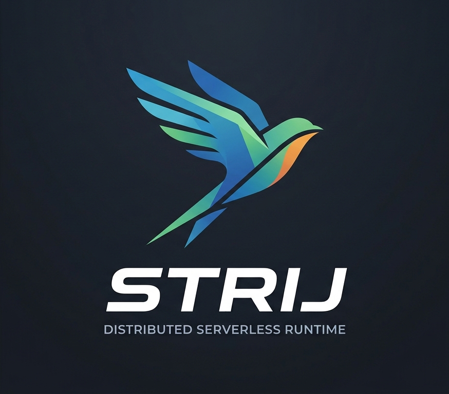

# Strij



Strij is a **distributed runtime for serverless functions**, written in C++23 for
Linux and built on `io_uring` for high-throughput, low-overhead asynchronous I/O.
It consists of gateway servers that accept task submissions and node agents that
execute them, and it is designed to scale horizontally: to thousands of nodes and
millions of concurrent tasks, with no single point of failure — multiple gateway
processes run side by side, and scheduling policies are pluggable so the placement
of work can be tuned or swapped out.

It is useful when you want to run short-lived functions across a cluster without
paying for an orchestrator's control plane or a heavyweight per-task runtime: a
task is a protocol message, a node claims it, and the result streams back. The
runtime handles node discovery, admission control, task routing, child-task and
result propagation, and a distributed event plane for `emit`/`listen`-style
workflows, while the actual function logic lives in replaceable task handlers
(e.g. the bundled [Open Workflow](https://open-workflow-specification.org/) interpreter).

Given you've got a fresh VM or a new Linux PC with Docker installed
for development just type in:

```bash
$ make env
```

After a moment or two you'll get into a brand new build environment
inside a Docker container.

Then check the initial fake targets build successfully:

```bash
$ make build
```

and the tests pass

```bash
$ make test
```

Now feel free to replace the fake bazel build targets with your own
real ones and build `compile_commands.json` to help your IDE do
auto-complete:

```bash
$ make compiledb
```

## Toolchain selection

By default the host compiler is used which is *gcc* usually. If you want to build
with the custom local *clang* toolchain add the following option to your build command:
`--extra_toolchains=//toolchain:cc_toolchain_for_linux_x86_64` or edit `.bazelrc`.

But first you need to get the toolchain. Options:

  1. unpack a binary distribution of clang and llvm tools to `./toolchain/clang`;
  2. build LLVM from source by cloning the LLVM project and running:

```bash
$ make llvm-toolchain LLVM_PROJECT_PATH=/path/to/repo/with/llvm-project
```

  3. install LLVM 23 from the official apt.llvm.org repository (the GitHub Actions
     ASan/TSan setup) on Ubuntu 24.04:

```bash
$ curl --fail --location https://apt.llvm.org/llvm.sh --output /tmp/llvm.sh
$ sudo bash /tmp/llvm.sh 23 all
$ ln -s /usr/lib/llvm-23 toolchain/clang
```

By default `LLVM_PROJECT_PATH` is set to `/path/to/this/repo/../llvm-project`.

With the clang toolchain available you can run tests with address and thread
sanitizers enabled. These targets set the sanitizer symbolizer path automatically:
they use libc++ with Clang.

```bash
$ make test_asan
$ make test_tsan
```

As well as `clang-tidy` checks:

```bash
$ make clang-tidy
```

## Code coverage

Run tests instrumentalized for collecting coverage statistics:

```bash
$ make coverage
```

The code coverage report should be in `./coverage` now.

## Configuration

Gateway and NodeAgent use YAML configuration files with layered overrides (defaults → YAML → env → CLI). See [docs/config.md](docs/config.md) for full documentation.

Quick start:

```bash
# Validate config without starting
./gateway --config_file config/gateway.yaml --validate_only

# Start with environment variable override
STRIJ_GATEWAY_HTTP_LISTENER_PORT=9090 ./gateway

# Start with CLI flag override
./gateway --http_port=9090 --log_level=debug
```
